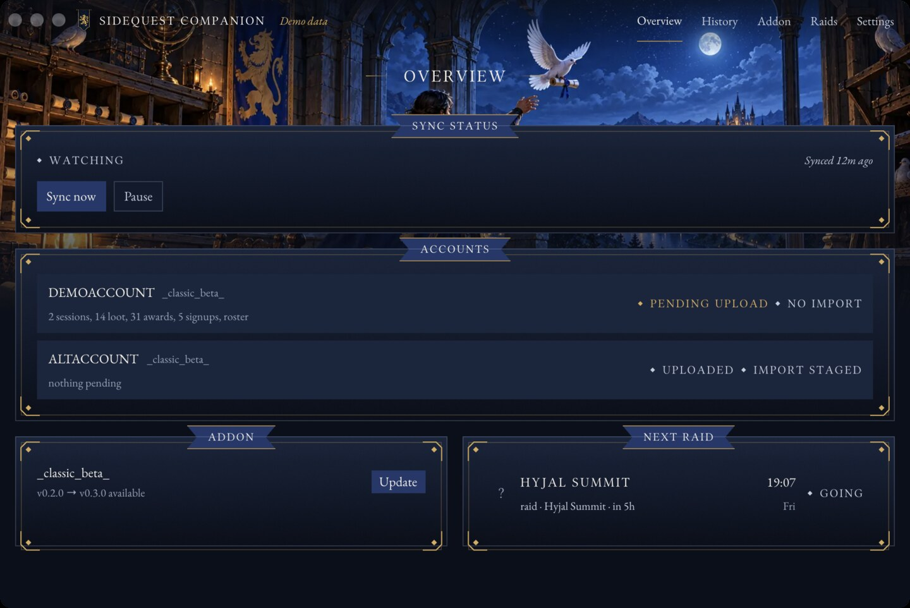

# SideQuest Companion

A system-tray app for the [SideQuest](https://github.com/SideQuest-Guild/addon) guild addon. It watches the addon's
save file, uploads new raid records to [sidequest-guild.com](https://sidequest-guild.com) as soon as they appear,
stages the site's reply back for the addon to pick up at your next `/reload`, keeps the addon itself up to date, and
reminds you before guild events. It's a small native app built with [GPUI](https://www.gpui.rs/) -- no browser, no webview,
just a window that draws itself.



## Install

Download the file for your system from the [latest release](https://github.com/SideQuest-Guild/companion/releases/latest):

| System | File |
|---|---|
| Windows (Intel/AMD) | `sidequest-companion-X.Y.Z-windows-x86_64-setup.exe` |
| Windows (ARM) | `sidequest-companion-X.Y.Z-windows-aarch64-setup.exe` |
| macOS (Intel or Apple Silicon) | `sidequest-companion-X.Y.Z-macos-universal.zip` |
| Linux (x86_64) | `sidequest-companion-X.Y.Z-linux-x86_64.tar.gz` |

**macOS:** unzip, drag `SideQuest Companion.app` wherever you like, and open it. The app is signed with an ad-hoc
signature (not a paid Apple Developer certificate), so the first launch is blocked by Gatekeeper. Either right-click
the app and choose **Open**, or run `xattr -d com.apple.quarantine "SideQuest Companion.app"` once, then launch it
normally from then on.

**Windows:** run the setup file. SmartScreen will warn about an unrecognized app the first time; click **More info**,
then **Run anyway**. This isn't a sign the file is unsafe. See [Verifying a download](#verifying-a-download) to check
it yourself. Setup installs the app for you alone (no admin prompt) in `%LOCALAPPDATA%\Programs\SideQuest Companion`,
adds it to the Start menu, and closes and replaces an older copy if one is running, including one you unzipped
yourself. Uninstall it from **Settings → Apps**; your sign-in and settings stay in `%APPDATA%` in case you reinstall.
The `-windows-x86_64.zip` holds the bare `sidequest-companion.exe` if you'd rather not install.

**Linux:** untar anywhere, then run `sidequest-companion`. The tarball also has a `.desktop` file and an icon if you
want it in your app launcher: copy `sidequest-companion.desktop` to `~/.local/share/applications/` and
`sidequest-companion.png` to `~/.local/share/icons/hicolor/256x256/apps/`, fixing the `Exec=`/`Icon=` paths to point
at where you put the binary.

## Set up

1. Open the companion and choose **Sign in with sidequest-guild.com**. Your browser opens the site's sign-in page
   with a short code; check it matches the code in the app and click **Authorize**. You need to be signed in to the
   site as a guild member. The app shows nothing else until you sign in, so people outside the guild see nothing.
2. That's it. The companion keeps its sign-in in your OS keyring, never in a plain settings file, and finds your WoW
   installation on its own, wherever Battle.net put it. If it can't, open **Settings → WoW Folders**, choose
   **Add folder** and pick your `World of Warcraft` folder.

Sites that are too old for browser sign-in still work: open **Use a token instead** in **Settings** and paste a sync
token from [sidequest-guild.com/officers/sync/](https://sidequest-guild.com/officers/sync/).

To sign out, use **Sign out** in **Settings**, or revoke the companion on your
[account page](https://sidequest-guild.com/account/). Either one cancels its sign-in on the site.

## What it does

Every member gets:

- **Addon updates:** the companion checks the addon's GitHub releases every hour, and every 15 minutes while WoW is
  running, against the version installed in your `AddOns` folder and installs a new one on its own, the same zip
  CurseForge serves, checked against the release's `SHA256SUMS.txt` first. Switch off **Install updates
  automatically** in Settings to install them in a click instead.
  WoW doesn't have to be closed: like CurseForge, it swaps the files in place, and the addon pops up a notice in game
  to `/reload`, which loads the new version. **Check for updates** on the Overview and Addon tabs checks right away
  instead of waiting for the next scheduled check. Click the chevron beside a flavor's installed version to pick from its
  released versions (drafts and prereleases aren't offered) and install that one instead of the latest -- handy for
  rolling back a release with a bug. Installing anything older than the latest pins it: the companion leaves that
  flavor alone until you install the latest again (the dropdown's "(latest)" entry, or **Back to latest** next to the
  "Pinned to vX" notice that replaces the update button while pinned), which also turns auto-update back on.
- **Event reminders:** a notification before guild events you're signed up for (or every event, your choice), for
  the kinds you pick (raids, dungeons, world bosses, socials and more), from your own calendar on the site.
- **App updates:** the companion checks its own releases every hour and, unless you switch off **Install app updates
  automatically** in Settings, installs a new version on its own after checking it the same way, then restarts into
  it. With the switch off it tells you a new version is out and installs it in a click.

Officers also get:

- **Auto-sync:** whenever the addon writes a new `SQX1:` export to `SideQuest.lua` (on logout or `/reload`), the
  companion uploads it within a few seconds and shows the result (new sessions, encounters, loot, awards) in its
  **History** tab.
- **Import staging:** after an upload, and every 5 minutes while WoW is running, the companion asks the site for
  the matching `SQI1:` game import and keeps it ready in a small addon folder it manages, `SideQuest_Inbox`, next
  to the SideQuest addon. Typing `/reload` in game always loads the newest one, whether or not WoW was ever
  closed. The first time this ships, WoW needs one full restart so it notices the new `SideQuest_Inbox` folder;
  after that, `/reload` is all it takes. Nobody has to copy and paste an import string by hand.

## Settings and logs

| What | macOS | Windows | Linux |
|---|---|---|---|
| Settings | `~/Library/Application Support/com.SideQuest-Guild.SideQuest-Companion/` | `%APPDATA%\SideQuest Guild\SideQuest Companion\config\` | `~/.config/sidequestcompanion/` |
| Logs | `~/Library/Application Support/com.SideQuest-Guild.SideQuest-Companion/logs/` | `%APPDATA%\SideQuest Guild\SideQuest Companion\data\logs\` | `~/.local/share/sidequestcompanion/logs/` |

Logs never contain your sync token, calendar URL, or raw addon export data.

## Verifying a download

Every release asset is built by GitHub Actions from a signed tag and attested with build provenance. With the
[GitHub CLI](https://cli.github.com/) installed:

```sh
gh attestation verify sidequest-companion-0.1.0-macos-universal.zip --repo SideQuest-Guild/companion
```

To check that a file is the one published in that release, which can't be changed after it's published:

```sh
gh release verify-asset v0.1.0 sidequest-companion-0.1.0-macos-universal.zip --repo SideQuest-Guild/companion
```

Or check it against the published checksums:

```sh
sha256sum --ignore-missing -c SHA256SUMS.txt
```

See [SECURITY.md](SECURITY.md) for what else is in scope and how to report a problem privately.

## Development

```sh
make install   # rustup components + cargo-deny
make ci         # fmt check, clippy, tests, cargo-deny -- same as CI
make run        # run the companion
make demo       # run it against fixture data, no real WoW install or network needed
```

On Linux you'll need GPUI's build dependencies first; see the `Install Linux build dependencies` step in
[`.github/workflows/ci.yml`](.github/workflows/ci.yml) for the exact package list. On macOS you need full Xcode
installed (not just the Command Line Tools), since GPUI compiles Metal shaders at build time.

`make bundle-macos` builds a release binary and assembles a local, ad-hoc-signed `SideQuest Companion.app` using the
same script (`packaging/macos/bundle.sh`) the release workflow uses, so you can test the bundle without waiting on CI.

Screenshots for this README live in `docs/screenshots/`: `gate.jpg`, `sign-in.jpg`, `overview.jpg`,
`overview-member.jpg`, `history.jpg`, `addon.jpg`, `events.jpg`, `settings.jpg`.

### Releasing

Commit subjects follow [Conventional Commits](https://www.conventionalcommits.org/).
[git-cliff](https://git-cliff.org/) builds `CHANGELOG.md` from them; `feat`, `fix` and `perf` commits are listed and
the rest are left out.

```sh
git cliff --tag v0.2.0 -o CHANGELOG.md
git commit -am "docs: changelog for v0.2.0"
git tag -s v0.2.0 -m "SideQuest Companion v0.2.0"
git push origin main v0.2.0
```

Pushing the tag builds every platform asset, writes that version's release notes, signs build provenance and an SBOM
for each asset, and publishes them as a GitHub release. A published release's files can't be changed, and `v*` tags
can't be moved or deleted, so a bad release is fixed with a new version.

To test the workflow without releasing, run it by hand from the Actions tab with the tag left blank. It builds and
signs every asset using the current `Cargo.toml` version and leaves a draft release named `dry-run-<run id>` that you
can delete. Running it by hand with an existing tag, such as `v0.1.0`, rebuilds and republishes that tag.

`main` takes signed commits only, and force pushes and deleting it are blocked.

## License

MIT. See `LICENSE`.
